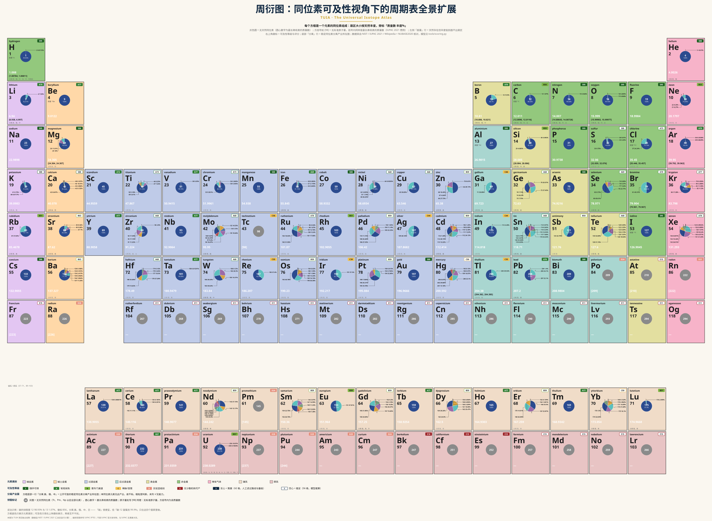
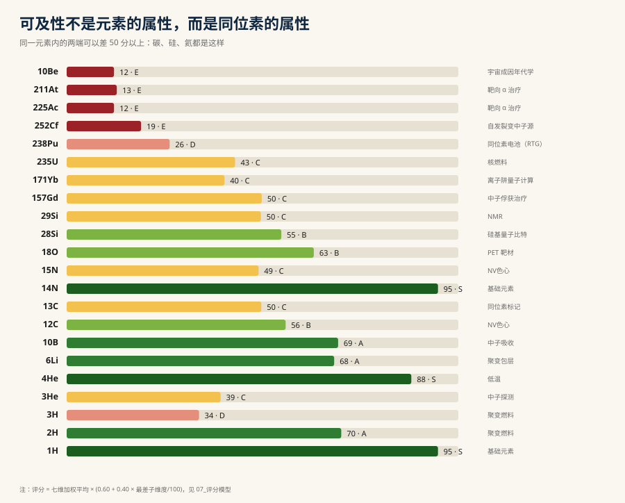

# 周衍图：同位素可及性视角下的周期表全景扩展

**TUIA · The Universal Isotope Atlas**

元素周期表回答「有哪些元素」；IUPAC 的同位素周期表（IPTEI）回答「它们有哪些同位素」。
这张表回答第三个问题：**这些同位素，你能不能拿到？拿多少？多贵？受什么限制？**



*周衍图：方框沿用 IUPAC 同位素周期表（IPTEI）的版式 —— 元素名、符号、原子序数、标准原子量
（含 `[39.792, 39.963]` 这样的区间值），以及按**天然丰度**绘制的同位素组成饼图。
每个同位素标签是两行：**质量数 + 丰度百分比**（如 `12 / 98.93%`），引线从扇区折出。
右上角的徽标是本图新增的一层：该元素**最容易拿到的那一个同位素**的可及性等级与评分。*

图上有两层信息，互不干扰：**底色 = 元素类别**（与 IPTEI 一致），**徽标 = 可及性**。
以 argon 为例：饼图里 36（0.3336%）与 38（0.0629%）是两条细缝、40（99.60%）占满其余；
原子量 39.95，区间 `[39.792, 39.963]`；徽标 A70 —— 氩总体好拿，但 `36Ar` 本身要富集到可用浓度是另一回事。

**置信度是画在图上的**：右上角徽标**实心 = 人工策展**（62 个元素，逐条读过路线与量级），
**空心 = 模型推定**（56 个元素，由丰度 + 元素级工艺 + 推定成本推出）。两种都写在图上，
但可信度不同 —— 后者只适合看趋势，不能用来做采购判断。

**关于氚**：`H` 的方框里只有 ¹H（99.99%）与 ²H（0.0115%）两个扇区，¹H、²H、³H 三兄弟并不都在饼里 ——
氚是**宇宙成因**核素，天然丰度在 10⁻¹⁵ 量级，画成扇区连一个像素都没有。这类核素在方框左侧用
`痕量 ³H` 单独标出（同理还有 ¹⁰Be、¹⁴C、²⁶Al、³⁶Cl、¹²⁹I），既不全漏掉，也不假装它们占有份额。

**关于「分离」那一行**：方框底部 `分离 美·俄·中·日` 是**稳定同位素分离产业所在国**。
单同位素元素（Be、Al、P、I、Au……）没有这条产线，所以没有这一行 —— 这也正是它们可及性高的原因。
碳的方框会告诉你：碳-12 富集只在四个国家里做。辐度与置信度见工作簿 `13_供应格局`。

> 只想看可及性分布时，用热力格版本更快：`docs/figs/tuia-heatmap.svg` —— 每格同样带一行分离产业国，
> 但省掉了同位素饼图，118 个元素一张屏看得完。

---

## 一、这张表从哪来

起点是一颗氮-空位（NV）色心金刚石。

NV 色心的量子相干时间被 `13C` 的核自旋浴压制 —— 碳在自然界是 `12C` 98.93% + `13C` 1.07%，
要拿到毫秒级的相干时间，就必须把 `13C` 压到千分之一以下。也就是说：
**化学上最普通的元素，在同位素维度上可以贵四个数量级。**

这个反差不是碳独有的。它提示了一件事：

> 元素在周期表里的位置是固定的，但**它的每一个同位素都是一个独立的产品**，
> 有各自的产线、价格、货期、许可与物理限制。

于是有了这张表：把「可获取性」当作与原子序数、丰度、半衰期并列的一根轴，重新排一遍。

---

## 二、可及性不是元素的属性



*同一个元素内部的两端可以差 50 分以上。`1H` 95 分、`3H` 34 分；`4He` 88 分、`3He` 39 分；
`12C` 56 分、`13C` 50 分。*

这正是本图想说的第一件事：**「碳」不是一个采购项，「碳-12」才是。**

---

## 二·补、图上怎么读（看缩略图前先看这四条）

| 看到什么 | 含义 |
|---|---|
| 饼图扇区大小 | 该元素的**天然同位素丰度**；扇区旁或圆内标「质量数 + 百分比」 |
| 灰色圆 + 圆内数字 | 该元素**没有天然同位素**（Tc、Pm、Np 及之后的全部元素），圆内数字 = 该元素的**质量数**（取值优先取 NIST/IUPAC 的标准原子量方括号值） |
| 原子量写 `[98]` | **没有标准原子量**（没有稳定同位素），方括号内是惯例采用的同位素质量数，与灰圆里的数字一致 |
| 左侧「痕量 ³H」之类 | 天然存在、但丰度低到画不出扇区（³H、¹⁰Be、¹⁴C、²⁶Al、³⁶Cl、¹²⁹I） |
| 右上徽标（如 `B56`） | 可及性**等级 + 评分**；**实心 = 人工策展**（62 个元素），空心 = 模型推定（56 个） |
| 底部「分离 美·俄·中」行 | 公开可查的**稳定同位素分离产业**所在国；单同位素元素没有这条产业，故不标 |

---

## 三、产出物

### 图（`docs/figs/`）

| 文件 | 用途 |
|---|---|
| `tuia-periodic.svg` | 矢量原图（3 872 × 2 838 设计单位），无限缩放 |
| `tuia-periodic.png` | 2 400 px 宽，嵌进工作簿 `02_周衍图` |
| `tuia-periodic@4k.png` | 3 840 px 宽，给网页首屏 / 截图 / 印刷 —— 图里最小字号（同位素标签 8.2px）在全宽下才读得出 |
| `tuia-heatmap.svg` / `.png` / `@2x.png` | 可及性热力格（与工作簿 `02b` 同构） |
| `tuia-focus-bars.svg` | 焦点核素评分条形图 |

### `dist/TUIA_同位素可及性全景扩展.xlsx`（20 个工作表）

| 工作表 | 内容 | 什么时候打开 |
|---|---|---|
| `00_封面` | 图名、论点、规模统计 | 第一次 |
| `01_导读` | 结构导航、口径、等级图例 | 第一次 |
| `02_周衍图` | 主图的静态大图（一页看全，100% 还原 SVG 排版） | 看整体格局 |
| `02b_可及性热力格` | 与周期表同构的格子版：元素 / 评分 / 分离产业国，可筛选 | 查细节 |
| `03_元素总表` | 118 元素 × 同位素统计 × 最佳可及核素 | 横向比较元素 |
| `04_IPTEI扩展` | IPTEI 的每元素视图 + 可及性列 | 对照官方图表 |
| `05_同位素全景` | 3 600 个核素逐条列出（质量、丰度、半衰期、自旋、评分） | 查单个核素 |
| `06_可及性目录` | 227 条人工策展：用途、路线、成本、量级、要点 | 读细节 |
| `07_评分模型` | 七维权重、工艺映射表、成本层级、等级阈值 | 改模型前 |
| `08_生产路线图鉴` | 12 条获取路线的门槛、周期、TRL、代表设施 | 理解为什么贵 |
| `09_再生闭环` | 哪些核素消耗后能「回炉」，哪些只能一次性消耗 | 本图的核心洞见 |
| `10_场景推演` | NV 色心、硅量子、靶向 α 治疗、聚变、双 β 等 11 个场景 | 把图用起来 |
| `11_数据源` | 逐字段出处与置信度 | 复核 |
| `12_使用与局限` | 口径、易错点、扩展方法 | 别踩坑 |
| `13_供应格局` | 59 个元素的分离产业国、置信度与依据 | 看供应链 |
| `14_同质异能态` | 2 050 条激发态（m-state）：激发能、半衰期、NUBASE 核对、按能级挂的说明 | 查 m 态 |
| `15_NUBASE对账` | 基态与激发态的逐条核对：一致 / 有差异 / 显著分歧 / NUBASE 无此能级 | 验数据 |
| `16_衰变链与发生器` | 由衰变分支算出的子体：36 对发生器候选 + 5 对异构体馈入 + 最长链 | 找发生器 |
| `17_中子截面` | ENDF/B-VIII.0 的 2200 m/s 截面、共振积分，与 α / 转换比 / 嬗变时间 | 算中子账 |
| `18_谱平均与自屏` | 六个谱下的平均截面、截面比随谱硬度的变化、NR 自屏 f 因子 | 看谱形影响 |

### 中间数据（`data/processed/`）

| 文件 | 说明 |
|---|---|
| `nist_all.csv` | NIST 全核素：原子序数、质量数、原子质量、天然丰度（3 352 条） |
| `isotopes_wiki.csv` | 半衰期、衰变模式、子体、自旋（3 494 条） |
| `tuia_nuclides.csv` | 合并后的全表，含推定可及性评分（3 600 行） |
| `tuia_focus.csv` | 策展目录（227 行） |
| `tuia_elements.csv` | 118 元素汇总 |
| `tuia_supply.csv` | 59 个元素的分离产业国与置信度 |
| `tuia_isomers.csv` | 2 050 条同质异能态（104 元素）：半衰期、衰变模式、自旋 |
| `nubase2020.csv` | NUBASE2020 全表解析（5 843 条：3 558 基态 + 2 285 非基态，含激发能与 Jpi） |
| `ame2020.csv` | AME2020 原子质量表解析（2 550 条：质量过剩、每核子结合能、原子质量） |
| `ame_vs_nist.csv` | 原子质量对账（2 537 条可比：1 348 完全一致 / 1 046 舍入级 / 143 显著差异） |
| `decay_graph.csv` | 逐条衰变边（6 588 条：母体/模式/分支%/子体） |
| `decay_chains.csv` | 每个核素的主导边、链长与「发生器候选」标记（36 对） |
| `xs_thermal.csv` | 35 条 ENDF/B-VIII.0 截面：σ(0.0253 eV)、共振积分、共振峰 |
| `xs_index.csv` | 由截面算出的 α、热谱转换比、嬗变时间、¹⁹⁷Au 校验 |
| `xs_spec.csv` | 6 个谱下的谱平均截面（19 行 × 6 谱） |
| `xs_shield.csv` | NR 自屏后的有效俘获截面与 f 因子（4 个核素 × 6 个 σb） |
| `nubase_vs_wiki.csv` | 基态半衰期逐条对账（3 099 条可比，2 932 条一致 = 94.6%） |
| `nubase_vs_isomers.csv` | 激发态逐条对账（2 050 条：一致 1 823 / 差异 56 / NUBASE 无 35 / 缺值 104） |

---

## 四、评分模型（一句话版）

```
TUIA = Base × (0.60 + 0.40 × min(S_A2 … S_A7) / 100)
Base = Σ w_i · S_i
```

七个维度：天然丰度（0.15）、分离/生产难度（0.20）、成本量级（0.20）、可得量级（0.15）、
供应成熟度（0.10）、管制负担（0.08）、纯化上限（0.12）。

* 加权平均衡量**总体**；短板折损衡量**最堵的那一环** —— 因为可获得性由最差的维度决定。
* 短板只在 A2–A7 上取：A1（天然丰度）是「白送的福利分」，不是工程瓶颈。人工核素丰度天然为 0，
  它真正的门槛已经体现在 A2（必须合成）上。
* 细节、映射表与可修改的参数见工作簿 `07_评分模型`。

等级：`S` ≥80 随手可得 · `A` 65–80 常规采购 · `B` 50–65 需专门渠道 ·
`C` 35–50 稀缺/受限 · `D` 20–35 实验室级别 · `E` <20 仅少数机构可产。

---

## 五、几条能直接读出来的结论

1. **元素的价值与同位素的价值不同步。** 碳的商品价以元/公斤计，`12C` 富集品以万元/公斤计，
   `13C` 更高，`14C` 则完全按活度计价 —— 同一个格子里是四个不同的市场。
2. **「半衰期短」不等于「拿不到」。** `99mTc`（6 h）、`18F`（110 min）都是成熟产品，
   因为它们被设计成「就地生产、就地使用」；真正难拿的是 `225Ac`、`211At` 这类
   既短寿命、产线又只有少数几条的核素。
3. **核素的稀缺常常不是化学问题，而是设施问题。** `99Mo` 的价格由研究堆的检修计划决定，
   `238Pu` 的稀缺来自 `237Np` 库存与能辐照它的反应堆，`188W` 的短缺来自高通量堆排期。
4. **能闭合的循环，等于把人造核素的半衰期变成了材料寿命。** `232Th → 233U`、`6Li → 3H`、
   `237Np → 238Pu`、`59Co → 60Co` 都是可回炉的；而 `3H → 3He`、`137Cs`、`90Sr` 是单向的。
   这一条单独放在 `09_再生闭环`。
5. **同位素分离产业高度收敛。** 把 59 个有分离产线的元素按国别数一遍：绝大多数只有「俄 + 美」两处，
   轻元素（H/C/N/O/B/Li/Si）才多出中国与日本，铀是唯一形成全球商业市场的例外。
   碳-12 富集贵，不是因为化学难，而是因为这条产线只在四个国家里 —— 见 `13_供应格局`。

---

## 六、重新生成

```powershell
# 1) 抓数据（首次运行会缓存到 data/raw/）
python tools/fetch_nist.py          # NIST 全核素质量与丰度
python tools/fetch_wiki.py all      # 逐元素同位素表（半衰期/衰变/自旋）
python tools/fetch_nubase.py        # NUBASE2020 / AME2020 原始表（IAEA AMDC）
python tools/parse_nubase.py         # NUBASE -> 结构化 CSV（下面 build_dataset 要用它的自旋）
python tools/parse_ame.py            # AME2020 -> 结构化 CSV（质量、质量过剩、结合能）

# 2) 合并 + 评分
python tools/build_dataset.py
python tools/extract_isomers.py      # 同质异能态（m-state）单表
python tools/qa_nubase.py            # 基态 + 激发态逐条对账
python tools/qa_ame.py               # 原子质量对账（AME2020 vs NIST）
python tools/decay_chains.py         # 衰变子体 → 衰变链与发生器

# 3) 中子截面（可选，只做增殖/嬗变判断时需要）
python tools/fetch_xs.py            # ENDF/B-VIII.0 逐点截面（JSON 镜像）
python tools/parse_xs.py            # → σ(0.0253 eV)、共振积分
python tools/xs_index.py            # → α / 转换比 / 嬗变时间
python tools/xs_spectrum.py         # → 谱平均截面 / 自屏 f 因子

# 3) 出图与工作簿
python tools/make_figure.py          # SVG
python tools/render_png.py           # SVG -> PNG（工作簿内嵌用）
python tools/build_workbook.py       # -> dist/TUIA_同位素可及性全景扩展.xlsx
```

依赖见 `requirements.txt`（`python -m pip install -r requirements.txt`）：
`pandas`、`numpy`、`lxml`、`html5lib`、`openpyxl`（≥3.1，富文本格子需要）、
`cairosvg` + `pillow`（SVG 转 PNG）。

扩展一个新核素：在 `tools/curation.py` 的 `CURATION` 里加一行
`(符号, 质量数, 标签, 路线, 成本层级 T0–T4, 量级, 要点)`，重跑第 2、3 步即可。

---

## 七、数据源与口径

| 字段 | 来源 | 置信度 |
|---|---|---|
| 原子序数、符号、质量数 | NIST *Atomic Weights and Isotopic Compositions* | 权威 |
| 原子质量、质量过剩、每核子结合能 | **AME2020 原表**（`mass_1.mas20.txt`）；2 550 条，与 NIST 转发值有 143 个核素差超过 1e-4 u | 权威 |
| 天然丰度 | 同上 | 权威 |
| 半衰期 | Wikipedia「Isotopes of *X*」118 页 + **NUBASE2020 逐条核对**（基态 3 099 条可比、**94.6% 一致**；激发态 1 823/2 050） | 汇编 + 核对 |
| 衰变模式与分支强度 | **NUBASE2020 的 BR 列**（含分支百分比，如 40K 的 β− 89.28% / β+ 10.72%） | 权威 |
| 自旋 I（Jpi） | **NUBASE2020**（评估值）；NUBASE 未收录的核素才回落到维基 | 权威 |
| 中子截面 | **ENDF/B-VIII.0**（NNDC，294 K）逐点截面；本仓取 30 个核素的 (n,γ)/(n,f)/(n,p)/(n,t)/(n,α) | 权威 |
| 成本层级、可得量级、管制负担 | 本仓人工策展（`tools/curation.py`） | **量级估计**，非报价 |
| 用途标签 | 人工策展 | 定性 |

**必须说清的三件事**

1. **可及性 ≠ 重要性。** 评分低说明「你必须就在它旁边生产」，不说明它没用。
2. **成本与量级是数量级判断。** T0–T4 用于横向比较；真实价格随反应堆档期、合同规模、
   同位素纯度波动，可能相差 3–5 倍。
3. **「策展」与「推定」要分清。** 227 条焦点核素是逐条读过路线与量级后写的；
   其余三千余条的评分由丰度 + 元素级工艺推出，只适合看趋势。

---

## 八、版权与署名

这张图**不是** IUPAC 的 IPTEI 官方图表，也**没有**使用它的任何原始文件（SVG / PDF / 位图）。
两者的关系只有一条：**编排思路参考**。

| 项目 | IUPAC IPTEI | 本图（TUIA） |
|---|---|---|
| 绘图方式 | IUPAC 官方绘制 | `tools/make_figure.py` 从数据现算现画 |
| 数据 | IUPAC 自己的汇编 | NIST + IUPAC 2021 标准原子量，脚本合并 |
| 方框尺寸 | ≈245×268 | 190×200（比例不同） |
| 配色 | IUPAC 自有色板 | 本项目自定义的 9 色类别板 |
| 同位素标签 | 仅质量数 | 质量数 **+ 丰度百分比**（本图新增） |
| 额外信息 | 无 | 可及性徽标、痕量核素行 |

**事实与数据本身不受著作权保护**（原子量、丰度、质量数都是自然事实），
周期表的 18 列排布是学科公共约定；受保护的是具体的**表达**——原始文件、精确版式与色板。
本图是独立绘制的，只借用了「元素方框里放同位素饼图」这一编排想法。

需要遵守的两条：

1. **不冒用名义**：图名、文件名、README 里都不出现「IUPAC 官方」「IPTEI 官方图表」这类表述；
   `IUPAC` / `IPTEI` 只作**描述性引用**（说明灵感来源），不使用其标识或 logo。
2. **保留免责声明**：SVG 底部与本节都写明「非 IUPAC 官方发布物、与 IUPAC 无隶属关系」。

数据侧另有两件事：

- **NIST** 的数据是美国政府作品，属公有领域；仍建议保留来源标注。
- **Wikipedia** 的正文是 CC BY-SA。本项目只从中提取**数值事实**（半衰期、自旋等），
  未复制其文字表述，因此不构成对其内容的再分发；但 README 与工作簿仍注明了来源，便于复核。

代码部分按仓库根目录的 Apache-2.0 授权。

---

## 九、目录结构

```
TUIA/
├─ dist/                          # 交付物（xlsx）
├─ requirements.txt               # 生成链依赖
├─ data/
│  ├─ raw/                        # 抓取的原始页面与 AMDC 原表（不入库）
│  └─ processed/                  # 合并后的 CSV（含 tuia_supply.csv）
├─ docs/
│  ├─ figs/
│  │  ├─ tuia-periodic.svg        # IPTEI 式方框 + 可及性徽标（主图，矢量）
│  │  ├─ tuia-heatmap.svg         # 可及性热力格（与工作簿 02b 同构）
│  │  ├─ tuia-focus-bars.svg      # 焦点核素评分条形图
│  │  ├─ tuia-periodic.png        # 2 400 px，嵌入工作簿
│  │  ├─ tuia-periodic@4k.png     # 3 840 px，网页首屏/印刷
│  │  └─ tuia-heatmap.png / @2x.png
│  └─ methodology.md              # 字段字典与模型细节
└─ tools/
   ├─ elements.py                 # 118 元素基础表 + 周期表版式
   ├─ scoring.py                  # 七维评分模型
   ├─ curation.py                 # 人工策展的可及性数据
   ├─ supply.py                   # 分离产业国别（人工策展）
   ├─ fetch_nist.py               # 数据抓取
   ├─ fetch_wiki.py
   ├─ fetch_nubase.py             # NUBASE2020 / AME2020 原始表
   ├─ parse_nubase.py             # NUBASE 固定宽格式解析
   ├─ parse_ame.py                # AME2020 固定宽格式解析
   ├─ qa_nubase.py                # 与 NUBASE2020 对账（基态 + 激发态）
   ├─ qa_ame.py                   # 与 AME2020 对账（原子质量）
   ├─ decay_chains.py             # 衰变子体、链长、发生器
   ├─ fetch_xs.py                 # ENDF/B-VIII.0 截面下载
   ├─ parse_xs.py                 # σ(0.0253 eV)、共振积分
   ├─ xs_index.py                 # α / 转换比 / 嬗变时间
   ├─ xs_spectrum.py              # 谱平均截面 / 共振自屏
   ├─ build_dataset.py            # 合并与评分
   ├─ extract_isomers.py          # 抽同质异能态（m-state）
   ├─ build_workbook.py           # 生成 xlsx
   ├─ make_figure.py              # 生成 SVG 配图
   ├─ render_png.py               # SVG -> PNG（cairosvg）
   └─ qa_report.py                # 数据自检
```

## License

见 `LICENSE`。
